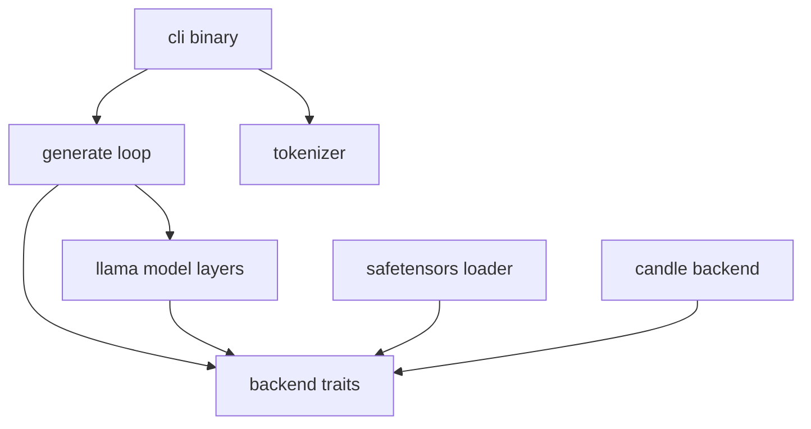
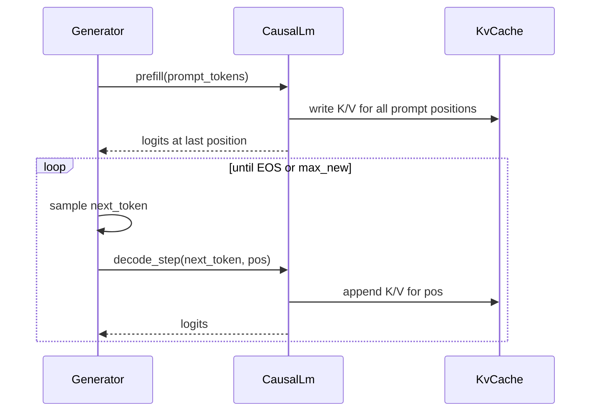

# Core Decode Loop — Phased Plan

## Locked decisions

- **Correctness target:** TinyLlama 1.1B Chat (`TinyLlama/TinyLlama-1.1B-Chat-v1.0`) — Llama architecture, HF `config.json` + `tokenizer.json` + `model.safetensors`.
- **First backend:** [Candle](https://github.com/huggingface/candle) (CPU first; CUDA later behind the same traits).
- **Non-goal for this stage:** continuous batching, paged KV, GGUF, multi-LoRA, serving APIs, speculative decoding.

Architecture reference (TinyLlama): 22 layers, hidden 2048, intermediate 5632, 32 Q heads / 4 KV heads (GQA), RoPE, RMSNorm, SwiGLU, vocab 32000, context 2048.

## Design principle: backend boundary

Model and generate-loop code must **not** import `candle_*` directly. They depend on traits in a `core` crate. Candle is one implementation.



**Trait surface (concrete choice):**

| Trait | Responsibility |
|-------|----------------|
| `Device` | CPU/CUDA selection, dtype policy |
| `Tensor` | shape, dtype, device; slice/cat/reshape; matmul; softmax |
| `Linear` / `Embedding` / `RmsNorm` | parameterized modules loaded from weights |
| `KvCache` | per-layer K/V append + read for decode |
| `CausalLm` | `prefill(tokens) -> logits`, `decode_step(token, pos) -> logits` |
| `Sampler` | greedy / temperature+topk (backend-agnostic on host logits) |

Associated-type generics (`Backend: BackendOps`) rather than `dyn Trait` for hot paths, so Candle stays zero-cost. A second backend later implements the same traits without changing the Llama layer code.

**Reference implementation:** Study Candle’s Llama example (`candle-examples/examples/llama`) and `candle_transformers::models::llama` for numerics and weight names — but **reimplement** layers in our crates behind our traits (no thin wrapper that freezes us to Candle’s types).

## Workspace layout

```
idea1/
  Cargo.toml                 # workspace
  crates/
    core/                    # traits, config, errors, sampler, generate
    models-llama/            # Llama blocks + TinyLlama wiring (backend-generic)
    backend-candle/          # Candle Device/Tensor/modules/KV/loader
    cli/                     # `idea1-infer` binary
  tests/
    fixtures/                # tiny golden logits / prompts (checked in or generated)
  README.md
```

Crate deps: `cli` → `core` + `models-llama` + `backend-candle`; `models-llama` → `core` only; `backend-candle` → `core` + `candle-*`.

---

## Phase 0 — Workspace scaffold

**Deliverable:** Compiling workspace with empty trait stubs and a CLI that prints `--help`.

- Create workspace + four crates; pin Candle / tokenizers / safetensors / serde / anyhow or thiserror / clap / hf-hub.
- Define error type (`EngineError`) and `ModelConfig` (deserialized from HF `config.json`, mapped to our Llama config).
- Document how to download TinyLlama (hf-hub in CLI or manual path).
- CI-ready: `cargo build` / `cargo test` on CPU.

**Exit criteria:** `cargo build -p cli` succeeds; no model load yet.

---

## Phase 1 — Config, tokenizer, weight discovery

**Deliverable:** Load TinyLlama metadata and tokenize/detokenize without running the model.

- Parse HF `config.json` → `LlamaConfig` (hidden size, layers, heads, KV heads, rope_theta, rms_norm_eps, vocab, max_seq_len, eos/bos).
- Load `tokenizer.json` via `tokenizers` crate; encode prompt → `Vec<u32>`, decode tokens → string (streaming-friendly buffer later).
- Resolve weight files: single `model.safetensors` or sharded via `model.safetensors.index.json`.
- CLI: `idea1-infer tokenize --model-dir ... --prompt "..."`.

**Exit criteria:** Known TinyLlama prompt encodes to a stable token id list (assert in unit test).

---

## Phase 2 — Backend traits + Candle tensor/modules

**Deliverable:** Candle implements the compute primitives the model needs; no full Transformer yet.

Implement in `core` then `backend-candle`:

- Device selection (`Cpu`, later `Cuda` if available).
- DType policy: CPU → `F32` for correctness; optional `F16`/`BF16` on GPU later.
- Ops used by Llama: embedding lookup, linear (`x @ W.T`), RMSNorm, SiLU, RoPE apply, reshape/transpose, matmul attention scores, softmax, concat along seq for KV, narrow/slice last-token logits.
- Weight loading: mmap safetensors into backend tensors / `Linear` / `Embedding` by HF tensor name (`model.layers.N...`).
- Unit tests: RMSNorm and a small matmul against hand-computed f32 values.

**Exit criteria:** Load one embedding matrix and one linear from TinyLlama weights; run a tiny op test on Candle CPU.

---

## Phase 3 — Llama building blocks (no full stack)

**Deliverable:** Correct layer primitives, tested in isolation where possible.

Implement in `models-llama` generic over `B: Backend`:

1. **RMSNorm**
2. **RoPE** (precompute cos/sin or compute on the fly; match Llama2/TinyLlama `rope_theta=10000`)
3. **GQA attention** (32 Q / 4 KV, head_dim 64): QKV projections, RoPE on Q/K, attention with causal mask on prefill, `repeat_kv` for GQA
4. **SwiGLU MLP** (`gate_proj`, `up_proj`, `down_proj`)
5. **Decoder layer** = Attn + residual + MLP + residual (pre-norm)

**Exit criteria:** Per-module shape tests; optional numeric smoke test with random weights.

---

## Phase 4 — KV cache + prefill vs decode

**Deliverable:** Explicit split between prefill (full prompt) and decode (one token).



- `KvCache`: one K and V buffer per layer, shape `[batch=1, n_kv_heads, seq, head_dim]`; append on decode; reset on new request.
- Prefill: forward all prompt tokens with causal mask; fill cache; return last-position logits.
- Decode: forward single token at `position`; attend to full cached K/V; append; return logits.
- Verify decode path is O(seq) attention length growth, not full recompute of prompt each step (assert via cache length / op counts in debug tests).

**Exit criteria:** Same logits for “recompute full sequence” vs “prefill + decode” on a short prompt (parity test on CPU f32).

---

## Phase 5 — Full model wire-up + sampling + generate loop

**Deliverable:** End-to-end text generation on TinyLlama.

- Assemble: embed → N decoder layers → final RMSNorm → `lm_head` (untied for TinyLlama).
- `Sampler`: greedy first; then temperature + top-k (and optional top-p).
- `Generator`: tokenize → prefill → loop decode/sample/detokenize → stop on EOS / max tokens.
- CLI: `idea1-infer generate --model-dir ... --prompt "..." --max-tokens 64 --temperature 0`.
- Streaming stdout decode (buffer incomplete UTF-8 / BPE pieces like Candle’s `TokenOutputStream`).

**Exit criteria:** Greedy generation produces coherent TinyLlama Chat output for a fixed prompt; deterministic under temperature 0.

---

## Phase 6 — Correctness hardening + docs

**Deliverable:** Confidence the loop matches a reference, plus clear README.

- Golden test: fixed prompt, temperature 0, compare first N token ids to a checked-in vector (generated once via our engine after manual cross-check against Candle’s llama example or `transformers` on the same machine).
- Logits smoke: optional dump of last-prefill top-5 token ids for debugging.
- README: build, download TinyLlama, run generate, crate map, how to add a backend (implement traits in new crate).
- Benchmarks (informal): tokens/s prefill vs decode on CPU — baseline only, not optimization focus.

**Exit criteria:** `cargo test` green without GPU; README walkthrough works on a clean machine with downloaded weights.

---

## Out of scope (later stages)

- Paged KV / continuous batching (vLLM-style)
- GGUF + quantization ladder (llama.cpp-style)
- Metal / Vulkan / custom CUDA kernels as new `backend-*` crates
- OpenAI HTTP server, grammars, multimodal

## Risk notes

- **Numeric parity:** f32 CPU is the source of truth; mixed precision can wait.
- **Memory:** TinyLlama ~2GB+ in f32; document that CPU f32 needs enough RAM, or default mmap + f16 if Candle device allows and parity tests still use f32.
- **Abstraction temptation:** keep traits thin — only ops Llama needs — avoid designing a full tensor framework up front.
